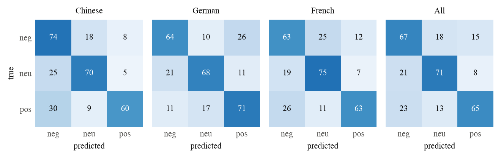
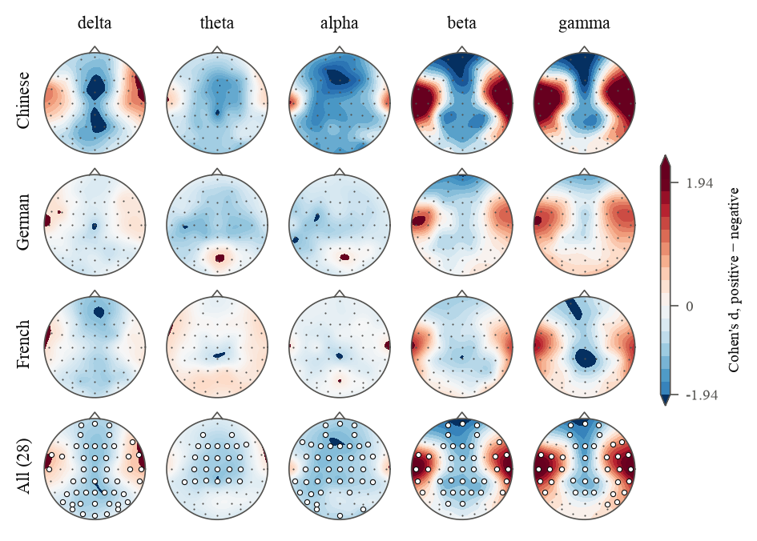

# SCVAE-XC: cross-cultural EEG + eye emotion recognition

**Can a model trained on one culture's brain signals read emotions in another culture?**

SCVAE-XC recognises whether a person is watching a positive, neutral or negative film from their **EEG and eye
movements**. It is trained on people from one or two cultures and tested on people from a culture it has never seen
(Chinese, German, French; SEED, SEED-GER, SEED-FRA datasets). It builds on SCVAE-Net, adding an eye-movement branch
and training on more than one culture.

## Results

| Task (trained on 2 cultures, tested on the 3rd) | Accuracy |
|---|---|
| Positive vs negative, one answer per film | **83%** (chance 50%) |
| Positive / neutral / negative, every 4-second window | **67.3%** (chance 33%) |
| Published methods re-run under the same rules: DCCA-AM / SCVAE-Net | 43.8% / 53.3% |

No test labels are used to choose a model or a training epoch.

### Confusion matrix



Rows are the true emotion, columns the prediction, in % of each true emotion (per-window, 3-seed ensemble).
Neutral films are recognised best. The most common mistake is reading a positive film as negative.

## Brain map



Each head is seen from above, nose at the top. **Red** means more brain activity during positive films, **blue**
more during negative films. Columns are frequency bands, rows are cultures. In all three cultures, positive films
show more **beta and gamma activity above the ears** (temporal electrodes T7/T8). White circles mark electrodes
that are significant across all 28 people.

## What's where

| Folder | Contents |
|---|---|
| `src/experiments/train_scvae_xc.py` | training SCVAE-XC |
| `src/baselines/` | the methods we compare against |
| `src/experiments/` | analysis, statistics, figures |
| `src/preprocessing/` | converting the raw SEED features |
| `cluster/` | job lists: one line = one training run |
| `results/tables/` | result tables |
| `demo/` | small web demo (FastAPI + Gradio) |
| `docs/` | experiment plans and [more details](docs/DETAILS.md) |

## How to run

### 1. Install

Python 3.10 or newer. A GPU helps but is not required (Apple Silicon `mps` and CPU also work).

```bash
git clone https://github.com/harsh-dubey10/SCVAE-XC.git && cd SCVAE-XC
python -m venv .venv && source .venv/bin/activate
pip install -r requirements.txt
```

### 2. Get and convert the data

The SEED datasets are licensed and not included. Request SEED, SEED-GER and SEED-FRA from
[BCMI, SJTU](https://bcmi.sjtu.edu.cn/home/seed/) and unpack them into `data/raw/SEED_CHN_MM`, `data/raw/SEED_GER`
and `data/raw/SEED_FRA`. Then convert each one to 4-second EEG + eye windows, for example German:

```bash
python -m src.preprocessing.convert_seed_crossculture --dataset GER --window-seconds 4 --modality eeg_eye \
    --source-dir data/raw/SEED_GER/02-EEG-DE-features/eeg_used_4s \
    --eye-dir data/raw/SEED_GER/04-Eye-tracking-feature/eye_tracking_feature \
    --output-dir data/processed/SEED_GER_EEG_EYE
```

Do the same for the other two cultures:

| Culture | `--dataset` | `--source-dir` | `--output-dir` |
|---|---|---|---|
| French | `FRA` | `data/raw/SEED_FRA/02-EEG-DE-features/eeg_used_4s` | `data/processed/SEED_FRA_EEG_EYE` |
| Chinese | `CHN` | `data/raw/SEED_CHN_MM/02-EEG-DE-feature/eeg_used_4s` (note: `feature`, singular) | `data/processed/SEED_CHN_MM_EEG_EYE` |

The `--eye-dir` is `<culture folder>/04-Eye-tracking-feature/eye_tracking_feature` in each case.

### 3. Train

Two cultures → the third (the main setting), EEG + eye:

```bash
python -m src.experiments.train_scvae_xc --sources SEED_GER SEED_FRA --target SEED_CHN_MM \
    --modality eeg_eye --seed 12 --learning-rate 0.0025 --input-noise 0.1
```

Settings used per test culture (chosen from the other two cultures only): Chinese `--learning-rate 0.0025 --input-noise 0.1`,
German `0.0025` and `0`, French `0.0005` and `0.1`.

- One training culture instead: `--sources SEED_GER`.
- EEG only: `--modality eeg`.
- One test person only (quick check): `--test-subject 1`.
- Results go to `results/scvae_xc/stage2/<target>/`.

The reported numbers average 3 seeds (`--seed 12`, `34`, `56`). Every run is listed in
`cluster/scvae_xc_stage2.txt`; on a SLURM cluster:

```bash
sbatch --export=ALL,MANIFEST=cluster/scvae_xc_stage2.txt,PACK=6 --array=1-9 cluster/scvae_xc_packed.sbatch
```

### 4. Results, statistics and figures

```bash
python -m src.experiments.summarize_scvae_xc_stage2   # accuracy table
python -m src.experiments.significance_tests          # paired tests over the 28 test people
python -m src.experiments.export_demo_model --out demo --target SEED_GER   # one model per test culture
SCVAE_XC_DEMO=demo python -m src.experiments.scalp_maps                     # brain maps
```

### 5. Demo

```bash
cd demo && pip install -r requirements.txt && python run_local.py
```

This opens a Gradio page in the browser. Pick a test culture and a clip, and the model predicts the emotion. It needs
the exported models from step 4 in `demo/models/`.
